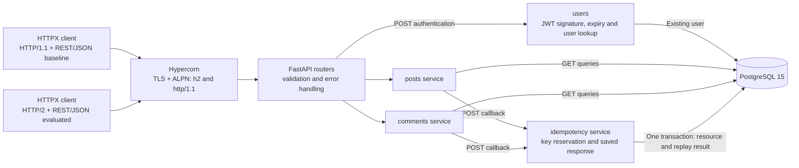
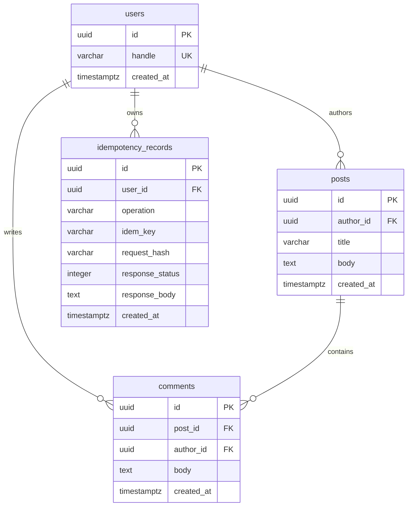
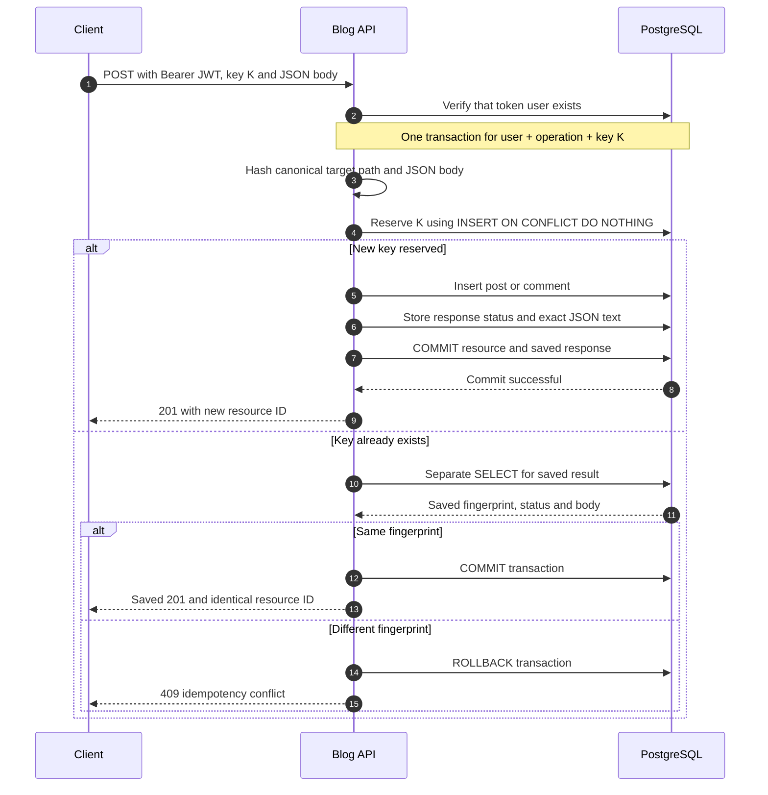
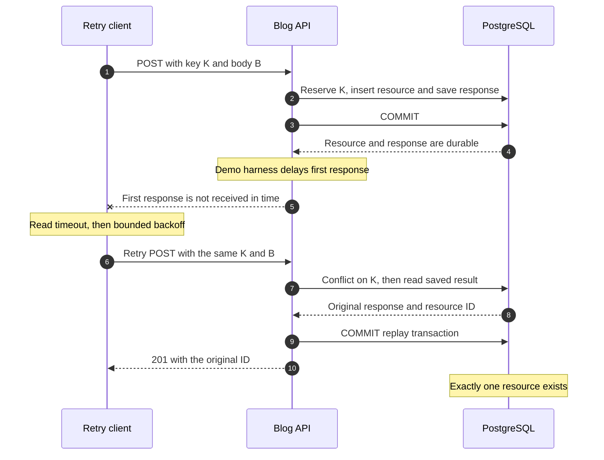
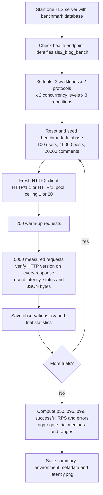
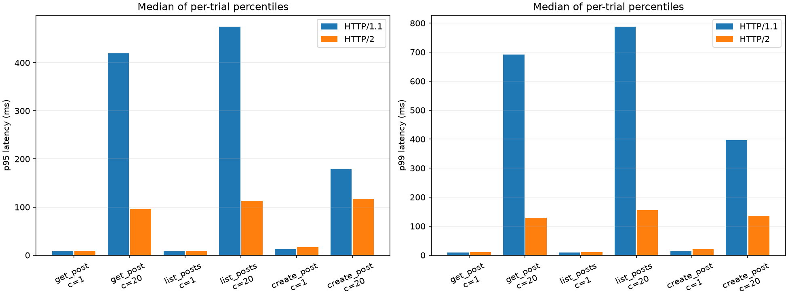

# SIS-2 Blog Platform

A Python implementation of the SIS-1 posts-and-comments API, with durable POST
idempotency, bounded client retries, and measured REST/JSON over HTTP/2 versus
the same API over HTTP/1.1.

**Python was approved by the instructor.** HTTP/2 is a documented refinement for
SIS-2: the original SIS-1 diagram specified REST/JSON but did not commit to HTTP/2.
The application uses FastAPI, Hypercorn and PostgreSQL 15.

Diagrams: [architecture](#runtime-architecture), [data model](#data-model),
[atomic writes](#atomic-post-and-replay), [timeout and retry](#timeout-after-commit),
and [benchmark](#measurement-flow).
The diagrams use [Mermaid blocks rendered by GitHub Markdown](https://docs.github.com/en/get-started/writing-on-github/working-with-advanced-formatting/creating-diagrams).

## Runtime architecture

Both clients reach one Hypercorn TLS listener and the same FastAPI application.
The application selects a database profile at startup: demo, test or benchmark.
POST requests verify the caller's JWT and use the shared idempotency service;
GET requests read through the relevant domain service.



`main.py` composes the routers. SQLAlchemy/asyncpg handle persistence, and Alembic
creates the schema. The same domain code and JSON schemas serve both HTTP versions.
HTTP/2 was chosen to evaluate concurrent REST reads using stream multiplexing and
header compression while retaining the SIS-1 JSON contract. The HTTP/1.1 baseline
uses the same TLS listener, application and database, keeping the comparison
focused on transport behaviour.

## Quick start: Windows PowerShell

Prerequisites: Python 3.12+, [uv](https://docs.astral.sh/uv/), and a local PostgreSQL
15 installation containing `initdb`, `pg_ctl` and `postgres`. Run commands from
this repository's root.

```powershell
# If PostgreSQL's tools are not already on PATH:
$env:POSTGRES_BIN = 'C:\Program Files\PostgreSQL\15\bin'

uv sync --frozen
uv run --frozen blogctl setup
uv run --frozen blogctl serve
```

`setup` generates private local credentials and TLS files, starts a dedicated
PostgreSQL instance on **127.0.0.1:55432**, creates and migrates three databases,
and inserts the demo fixtures. It can be run again without deleting demo data.
The existing PostgreSQL service on port 5432 is independent.

The API listens on **https://localhost:8443**. Leave the server terminal open.
In another PowerShell terminal, verify both negotiated protocols:

```powershell
uv run --frozen blogctl verify-protocols
uv run --frozen blogctl demo --output reports/demo-results.json
```

The second command starts its own temporary TLS server, exercises the application,
and exits. It demonstrates a write over HTTP/1.1, replay over HTTP/2, a `409`
conflict, identical GET bytes and a timeout after commit followed by a safe retry.
Fault injection exists only in this demonstration/test harness.

The generated local CA is trusted explicitly by the Python clients. It is not
installed in the Windows certificate store. A browser may therefore show a
certificate warning for `/docs`; the CLI uses certificate verification throughout.

## Application layout

Code is grouped by application/domain, in the same spirit as Django apps:

```text
src/blog_service/
  main.py                 # App composition and health check
  posts/                  # models, schemas, router, service
  comments/               # models, schemas, router, service
  users/                  # user model and JWT authentication
  idempotency/            # durable key model and atomic result replay
  core/                   # settings, database, errors, pagination, shared schemas
  cli.py                  # blogctl commands
  local.py                # dedicated local PostgreSQL lifecycle
  certificates.py         # local CA and TLS certificate generation
  seed.py                 # deterministic datasets
  retry_client.py         # bounded retry policy
  benchmark.py            # real TLS measurements and artifacts
  demo.py                 # local defence scenario and test-only delay wrapper
migrations/               # Alembic schema history
tests/                    # PostgreSQL, API, retry and real TLS checks
reports/                  # submission report and observed results
```

Domain services contain data operations; routers define HTTP contracts. Shared
idempotency executes a domain write callback in the same transaction as the saved
result. `core/model_registry.py` registers every domain model for Alembic.

## Data model

Users author posts and comments. Each comment belongs to one post. Durable
idempotency records belong to the authenticated user and store the result of a
completed write.



The idempotency uniqueness rule is composite:
`UNIQUE (user_id, operation, idem_key)`. The request hash also includes the target
path, so reusing a comment key for a different post produces a conflict.
Indexes on `(author_id, created_at DESC, id DESC)` for posts and
`(post_id, created_at DESC, id DESC)` for comments support the paginated queries.
Reservation fields are filled before commit; an incomplete reservation is never
committed independently of its resource.

## API

| Method | Path | Successful response |
|---|---|---|
| POST | `/v1/posts` | `201 {"id":"UUID"}` |
| GET | `/v1/posts/{post_id}` | `200` full post |
| GET | `/v1/authors/{author_id}/posts?limit=20&cursor=...` | `200 {"items":[],"next_cursor":null}` |
| POST | `/v1/posts/{post_id}/comments` | `201 {"id":"UUID"}` |
| GET | `/v1/posts/{post_id}/comments?limit=20&cursor=...` | `200` paginated comments |
| GET | `/health` | Database health and selected database name |

Post input is `{"title":"Hello","body":"World"}`; comment input is
`{"body":"A comment"}`. Titles contain 1–200 characters; bodies must be nonempty.
Unknown input fields, including `author_id`, are rejected. Responses identify
the author using the authenticated user's UUID.

GET endpoints are public. Both POST endpoints require `Authorization: Bearer …`
and an `Idempotency-Key`. Create a token for the seeded demonstration user:

```powershell
$demoToken = uv run --frozen blogctl token
$demoHeaders = @{
    Authorization = "Bearer $demoToken"
    'Idempotency-Key' = 'my-first-post'
}
```

Tokens use HS256 with the generated local secret, an existing user's `sub`, and
an expiration time. The prototype provisions users through seed data.

Lists use keyset pagination ordered by `(created_at DESC, id DESC)`, with default
limit 20 and allowed range 1–100. Pass `next_cursor` back unchanged. Invalid
cursors return `400`; invalid UUIDs, bodies and limits return `422`; missing
posts return `404`; an unknown author's feed is empty. Errors consistently use
`{"error":{"code":"…","message":"…"}}`.

## Idempotency, timeouts and retries

Keys contain 1–128 ASCII letters/digits or `._:-` and are scoped to user and
operation. A canonical hash includes the request body and target path. An
identical retry returns the exact saved `201` bytes. Reusing the key with changed
content, or a different target post within the comment operation, returns `409`.

Reservation, resource insertion and response storage commit atomically in
PostgreSQL. Concurrent identical requests wait on the unique constraint and
replay the result. The conflict path uses a separate `SELECT` under
`READ COMMITTED`. Records have **no automatic expiry** in this prototype; their
protection lasts until their database is explicitly reset. Missing/invalid keys
return `400`.

### Atomic POST and replay

The diagram covers both post and comment creation. A competing insertion waits
for the first transaction's outcome; the existing-key path then reads the saved
result with a separate SQL statement. A failure before commit rolls back the
reservation and the resource together.



SQL connections use a 1-second lock timeout and a 3-second statement timeout.
Database failures return `503` and `Retry-After: 1` after rollback.

`retry_request` uses explicit connect/pool timeouts of 1 second, read/write
timeouts of 2 seconds, at most 3 attempts, and an 8-second total budget. Backoff is
100/200 ms plus 0–50 ms jitter; `Retry-After` is honoured within the budget.
GET and keyed POST may retry transient network errors and `502/503/504`.
Unkeyed POST and ordinary `4xx` responses are not retried. A final HTTP error is
returned for inspection; a final network error is raised; exhaustion of the total
budget raises `RetryDeadlineExceeded`. Retried bodies must be reusable JSON or
bytes rather than streaming uploads.

### Timeout after commit

The client cannot infer whether a write committed from a read timeout. Retrying
with the same key and body retrieves the committed result instead of inserting
another resource. The demo uses a short read timeout and deliberately delays the
first response after commit; the standard server has no fault-injection route.



## Reproduce the benchmark

Run a dedicated benchmark server in a separate terminal:

```powershell
uv run --frozen blogctl serve --database bench --port 8444
```

Then run the complete matrix:

```powershell
uv run --frozen blogctl benchmark --base-url https://localhost:8444
```

Defaults: three operations (`get_post`, `list_posts`, `create_post`), concurrency
1 and 20, both protocols, three repetitions, 200 warm-up requests and 5,000
measured requests per trial: **36 trials and 180,000 measured requests**.
Protocol order alternates between repetitions. Runtime depends on the machine;
allow several minutes or longer. Keep the machine idle during measurements.

For a short verification run:

```powershell
uv run --frozen blogctl benchmark --base-url https://localhost:8444 --requests 40 --warmup 20 --repeats 1
```

Before every trial, only the dedicated benchmark database is reset to 100 users,
10,000 posts and 20,000 comments. Post/comment bodies are 2,048/256 ASCII bytes.
The command checks that the target server's health endpoint identifies the
benchmark database. Benchmark POST keys are distinct, fixed-length UUID strings.

### Measurement flow

Each trial selects one workload, protocol and concurrency level. The next trial
starts from the same seed data and a fresh client pool. Across the complete
matrix, protocol order alternates between repetitions.



Warm-up responses also undergo protocol verification. An unexpected HTTP version
invalidates the run. Measured requests have no automatic retries, so errors remain
visible in the recorded observations. Dataset reset, warm-up and artifact writing
are outside each trial's measured batch.

Each output directory contains:

- `observations.csv`: every measured request, including errors and HTTP version.
- `trials.csv`: duration, successful RPS, error rate and successful-request p50/p95/p99.
- `summary.csv` and `SUMMARY.md`: medians and ranges of per-trial statistics.
- `metadata.json`: environment, versions, dataset, pools and measurement policy.
- `latency.png`: p95/p99 comparison chart.

Both protocols use the same TLS server and connection ceilings. Clients verify
the actual protocol for every response; fallback invalidates a run. Latency
includes connection-pool waiting and full response reading. JSON/key generation
and artifact writing occur outside each request's measured interval. Automatic
retries and body compression are disabled in benchmark requests.

The server allows 100,000 requests per connection for both protocols, above the
5,200 requests in a trial. This keeps connection rotation outside the measurement.
Database session dependencies finish before response transmission, so a connection
closure cannot strand a completed read transaction.

Body byte counts are actual serialized JSON lengths. Header-field byte counts
are sums of name/value lengths; they are **not TLS, HPACK or on-wire sizes**.
Identical JSON content is expected to have the same body size over both protocols.

### Recorded results

The completed full run contains **36 trials, 180,000 measured requests and zero
errors**. The chart shows medians of per-trial p95/p99 values. Individual trials,
raw observations and environment settings are preserved with the results.



See the [result table](reports/runs/full/SUMMARY.md),
[raw observations](reports/runs/full/observations.csv), and
[SIS-2 report](reports/SIS2_REPORT.md) for the measurements and their limits.

## Validation and database lifecycle

```powershell
uv run --frozen pytest -q --junitxml=reports/test-results.xml
uv run --frozen ruff check src tests migrations
uv run --frozen ruff format --check src tests migrations

uv run --frozen blogctl db-stop
uv run --frozen blogctl db-start
```

Tests use real PostgreSQL in `sis2_blog_test`. Protocol negotiation and socket
timeout tests use actual TLS connections; ordinary API checks use ASGI transport.
Tests also verify concurrent duplicate writes, rollback, pagination ties, JWT
rejection and saved results across application restart. Automated tests support
correctness; the assignment explicitly requires the protocol comparison and
measured latency/payload results.

The databases are `sis2_blog` (demo), `sis2_blog_test` (checks), and
`sis2_blog_bench` (measurements). `seed --reset` is restricted to the local test
and benchmark databases. `.env` and `.local/` contain private credentials, keys,
logs and data and are ignored by Git. Normal development uses the local cluster
without OS service installation.

`POSTGRES_BIN` can select an installation on another machine. POSIX wrappers use
the same Python commands and PostgreSQL programs, but Windows is the validated
execution environment. The source checkout is required for local tools/migrations.

See [the SIS-2 report](reports/SIS2_REPORT.md) and
[the defence walkthrough](reports/DEFENCE.md) for submission materials.
