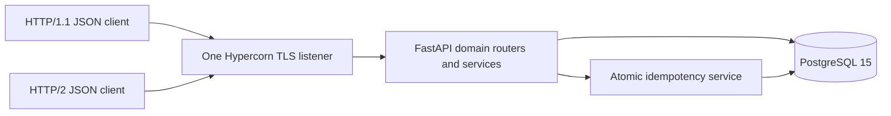
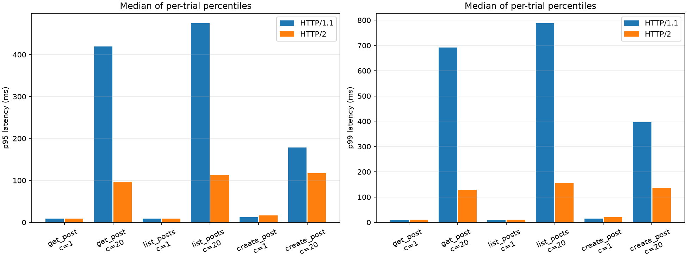

# SIS-2: Blog Platform protocol implementation

## Assignment and relationship to SIS-1

The assignment requires a service interface using a justified protocol, with
idempotency, timeouts and retries, plus latency and payload-size measurements
against a REST/JSON baseline. **The instructor approved Python** for this submission.

SIS-1 designed a Blog Platform supporting post publication, reading by ID,
author feeds, comments and cursor pagination. It specified a REST/JSON public
API, PostgreSQL tables and indexes, and a production architecture with caches,
replicas, outbox invalidation and horizontally scaled application instances.
The original design did not explicitly choose HTTP/2. This submission records
HTTP/2 as a refinement chosen and evaluated in SIS-2.

The SIS-1 targets are 4,000 read RPS, 200 write RPS, 5 million posts, and p99 below
120 ms. Capacity estimates such as 12 instances at 500 RPS and an 85% cache hit
rate were assumptions. This prototype's local observations do not validate those
production estimates or single-node-failure durability.

## Implemented system

One FastAPI application runs under Hypercorn, with PostgreSQL 15 persistence.
Code is organised into `posts`, `comments`, `users` and `idempotency` applications.
Each content application owns its models, schemas, router and service. Shared
configuration, database lifecycle, pagination and errors live in `core`.

The prototype implements the five SIS-1 endpoints. POST returns `201 {"id":...}`;
GET returns full records or `{items,next_cursor}`. Lists are ordered by
`created_at DESC, id DESC`, with keyset cursors and limits 1–100, default 20.
UUIDv4 identifies newly written resources; fixed UUIDv5 values make seed fixtures
reproducible. Timestamps use UTC. The composite indexes match the pagination order.

Writes verify HS256 JWT signature, expiration and an existing user's UUID subject.
User identity comes from the token; author IDs in request bodies are rejected.
Seed and token commands provide demonstration identities. Errors have one JSON
shape, documented in the API and generated OpenAPI schema.

## Protocol choice and comparison

The evaluated interface is **REST/JSON over HTTP/2**. The baseline is **the same
REST/JSON API over HTTP/1.1**. Both use the same TLS listener, app, database,
serialization, routes and authentication. Hypercorn advertises `h2` and
`http/1.1` using ALPN. [Hypercorn HTTP/2 documentation](https://hypercorn.readthedocs.io/en/latest/discussion/http2.html)

HTTP/2 is relevant to concurrent reads because it multiplexes streams and
compresses headers. It does not replace JSON serialization. HTTPX's `http2=True`
can fall back, so the measurement code checks the actual version of **every**
received response. A mismatch invalidates the run. [HTTPX HTTP/2 documentation](https://www.python-httpx.org/http2/)

Identical JSON content should therefore have identical body byte counts.
The experiment evaluates transport behaviour rather than a Protobuf-versus-JSON
serialization advantage. A latency improvement is an observation to establish,
not a consequence assumed from the HTTP version.

## Idempotency and failure handling

Both POST routes require an idempotency key. The table has a unique constraint
on `(user_id, operation, idem_key)`, a canonical SHA-256 fingerprint, response
status and exact UTF-8 response text. The fingerprint includes the normalised
target path and validated JSON body.

Within one transaction the service reserves the key, invokes the relevant
domain write, saves the result, and commits before sending a response. Concurrent
insertions wait on the constraint. A conflicting reservation is followed by a
separate `SELECT` under `READ COMMITTED`, giving a fresh snapshot after the first
transaction finishes. [PostgreSQL isolation documentation](https://www.postgresql.org/docs/15/transaction-iso.html)

An identical replay returns the same status and bytes. Different content or a
different target post within the comment operation returns `409`. A pre-commit
failure rolls back both resource and reservation; loss of the response after
commit leaves a durable result for a retry. Keys do not expire automatically;
their guarantees last until an explicit database reset.

Database connections limit lock waiting to 1 second and individual SQL statements
to 3 seconds. Database errors return `503` with `Retry-After: 1`. Session
dependencies have function scope and close before response transmission. This
also releases read transactions before a possible network disconnect.
[FastAPI dependency lifecycle](https://fastapi.tiangolo.com/tutorial/dependencies/dependencies-with-yield/)

The demonstration client has connect/pool timeouts of 1 second, read/write
timeouts of 2 seconds, and an 8-second total deadline. At most three attempts use
100/200 ms exponential backoff and 0–50 ms jitter. `Retry-After` is honoured within
the total deadline. Only GET and keyed POST retry transient network failures and
`502/503/504`; ordinary `4xx` and unkeyed POST are not retried. The total deadline
also bounds retry sleeps. Read timeouts alone limit inactivity between reads,
so an outer deadline bounds the complete operation. [HTTPX timeouts](https://www.python-httpx.org/advanced/timeouts/)

## Benchmark methodology

- One Hypercorn process/worker, real TLS sockets, and a shared PostgreSQL instance
  on the same Windows machine. The dedicated benchmark database is independent
  of demo and test data.
- Workloads: a fixed post GET, one author page of 20 posts, and POST creation.
- Matrix: both protocols, concurrency 1 and 20, three repetitions, 200 warm-up
  requests and 5,000 measured requests per trial. Protocol order alternates.
- Before every trial restore 100 users, 10,000 posts and 20,000 comments. Post
  bodies contain 2,048 ASCII bytes; comment bodies contain 256. POST requests use
  distinct keys of equal length.
- Connection and keep-alive pool ceilings both equal concurrency. Actual TCP
  connection counts can differ because HTTP/2 multiplexing is part of the test.
- Both protocols allow 100,000 requests per server connection, above one trial's
  request count. Idle keep-alive timeout is 30 seconds; HTTP/2 allows 100 streams.
- Measure from HTTPX send until full response reading, including connection-pool
  waiting. Prepare JSON and keys beforehand; save artifacts after each batch.
- Disable retries and response body compression. Log every measured attempt,
  including failures. Quantiles use successful requests and linear interpolation;
  successful RPS is successes divided by the entire measured batch duration.
- Summaries take medians of per-trial statistics and preserve their ranges;
  individual trials and requests remain available for inspection.
- Measure actual request/response JSON bytes. Header measurements sum field-name
  and value lengths; TLS/HPACK wire bytes are **not measured**.

The environment and exact versions are recorded in the completed run's metadata.
This is a local, closed-loop experiment. Client/server CPU contention, operating
system scheduling, disk durability and the database all influence the result.

## Correctness evidence

The completed automated suite contains **62 passing tests**, using real
PostgreSQL for persistence. Real TLS tests verify both protocol versions, payload
equality, replay across protocols, and read timeouts after commit. Additional
checks cover concurrent duplicates, rollback, app restart, cursor ties, JWT
rejection, retry limits and release of read transactions before response sending.
The recorded results are in [test-results.xml](test-results.xml).
The standard server's negotiated versions are saved in [protocols.json](protocols.json).
The [artifact validation record](validation.json) checks observation counts,
protocols, error totals, body sizes and the raw CSV checksum.

[demo-results.json](demo-results.json) records the executable defence scenario:
cross-protocol replay, changed-body conflict, identical GET bytes, and a timed-out
write recovered on its second attempt with one stored resource.

## Measurements and findings

The completed run contains **36 trials and 180,000 measured requests**, with **0 errors**.
It ran from `2026-10-30T18:23:19.827828+00:00` to `2026-10-30T18:46:41.380766+00:00` (UTC); elapsed wall time was **23.4 minutes**, including resets and warm-up.

[Raw observations](runs/full/observations.csv), [individual trials](runs/full/trials.csv), [summary and ranges](runs/full/summary.csv), and [full metadata](runs/full/metadata.json) are retained.

| Environment | Observed value |
|---|---|
| OS | Windows-11-10.0.22631-SP0 |
| CPU | Intel64 Family 6 Model 183 Stepping 1, GenuineIntel; 10 physical / 16 logical cores |
| RAM | 15.63 GiB |
| Python | 3.12.6 |
| PostgreSQL | PostgreSQL 15.7, compiled by Visual C++ build 1939, 64-bit |
| FastAPI / Hypercorn / HTTPX | 0.162.0 / 0.18.0 / 0.28.1 |

The following values are medians of three per-trial statistics. Errors and requests are summed across those trials. Latency percentiles cover successful requests.

| Protocol | Workload | Concurrency | p50 ms | p95 ms | p99 ms | Success RPS | Errors / requests |
|---|---|---:|---:|---:|---:|---:|---:|
| HTTP/1.1 | get_post | 1 | 6.463 | 8.644 | 9.635 | 149.564 | 0 / 15000 |
| HTTP/2 | get_post | 1 | 6.445 | 8.864 | 9.966 | 145.948 | 0 / 15000 |
| HTTP/1.1 | get_post | 20 | 60.308 | 419.886 | 692.379 | 161.492 | 0 / 15000 |
| HTTP/2 | get_post | 20 | 57.664 | 95.019 | 129.230 | 321.732 | 0 / 15000 |
| HTTP/1.1 | list_posts | 1 | 5.211 | 8.647 | 9.886 | 165.158 | 0 / 15000 |
| HTTP/2 | list_posts | 1 | 5.696 | 9.079 | 10.684 | 162.673 | 0 / 15000 |
| HTTP/1.1 | list_posts | 20 | 66.071 | 474.860 | 787.813 | 142.867 | 0 / 15000 |
| HTTP/2 | list_posts | 20 | 63.141 | 112.780 | 155.364 | 284.797 | 0 / 15000 |
| HTTP/1.1 | create_post | 1 | 7.979 | 12.208 | 14.938 | 109.650 | 0 / 15000 |
| HTTP/2 | create_post | 1 | 9.075 | 16.744 | 20.721 | 95.286 | 0 / 15000 |
| HTTP/1.1 | create_post | 20 | 84.914 | 178.527 | 396.057 | 206.034 | 0 / 15000 |
| HTTP/2 | create_post | 20 | 85.744 | 116.926 | 135.669 | 232.914 | 0 / 15000 |

### JSON body sizes

| Workload | Request bytes H1 / H2 | Response bytes H1 / H2 |
|---|---:|---:|
| get_post | 0 / 0 | 2219 / 2219 |
| list_posts | 0 / 0 | 44519 / 44519 |
| create_post | 2084 / 2084 | 45 / 45 |

Body lengths match across protocols. Exact GET/replay byte equality is additionally verified by real TLS tests. Separate fresh POST requests create different UUIDs of the same length, so equal POST sizes alone do not imply identical content.

### Interpretation

At concurrency 20, the observed HTTP/2-to-HTTP/1.1 ratios were:

| Workload | Successful RPS ratio | p99 latency ratio |
|---|---:|---:|
| get_post | 1.99 | 0.19 |
| list_posts | 1.99 | 0.20 |
| create_post | 1.13 | 0.34 |

A throughput ratio above 1 favours HTTP/2; a latency ratio below 1 favours HTTP/2.

These observations compare the complete client/server/database pipeline in this environment. They do not isolate header compression, multiplexing, CPU scheduling or database costs individually. Sequential results and trial-to-trial ranges should be considered alongside the concurrent results.

The measured payload-size difference is zero for the matching JSON bodies. No compressed-header or TLS wire-byte saving is claimed. The experiment does not establish the SIS-1 production RPS/latency goals, a mixed read/write workload, or failure tolerance.

## Initial run diagnosis

An initial full run stopped after two trials. Its HTTP/2 trial recorded five
`RemoteProtocolError` failures near the default 1,000-request connection limit,
and unfinished read transactions subsequently prevented a database reset.
The failed run is preserved in [failed-initial/metadata.json](runs/failed-initial/metadata.json)
and [its raw observations](runs/failed-initial/observations.csv).

The final configuration uses the same 100,000-request limit for both protocols
and closes database sessions before response transmission. Regression checks
verify that each read route has released its transaction at response start.
The initial run is excluded from the final performance summary.
Hypercorn documents the default connection limit as 1,000 requests.
[Hypercorn configuration](https://hypercorn.readthedocs.io/en/latest/how_to_guides/configuring.html)

## Reproduction

From the repository root, run `uv sync --frozen` and `uv run --frozen blogctl setup`.
Start `uv run --frozen blogctl serve --database bench --port 8444` in one terminal.
In another, run `uv run --frozen blogctl benchmark --base-url https://localhost:8444`.
The command creates a fresh output directory, preserving earlier runs.

The [README](../README.md) gives setup, API, lifecycle and validation commands;
[DEFENCE.md](DEFENCE.md) provides the live walkthrough.
